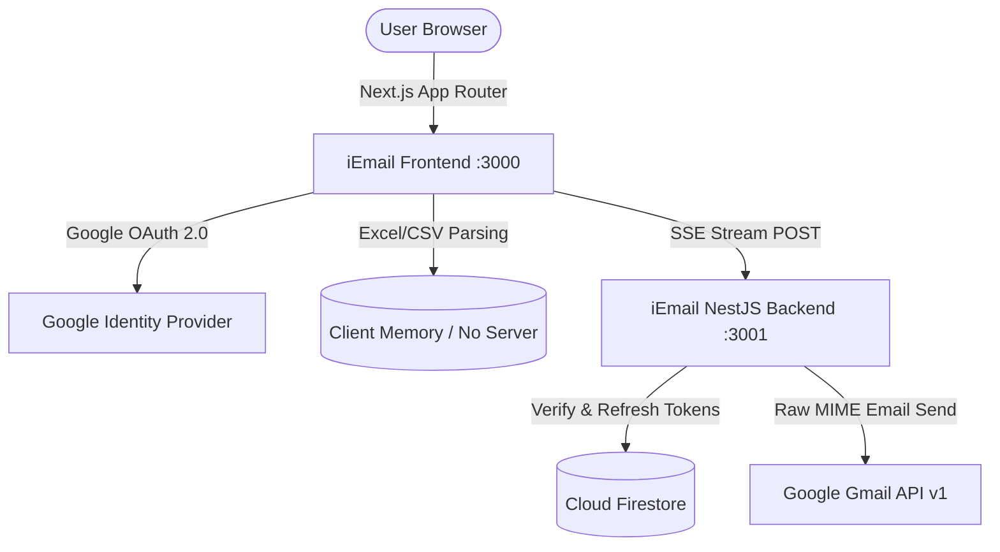
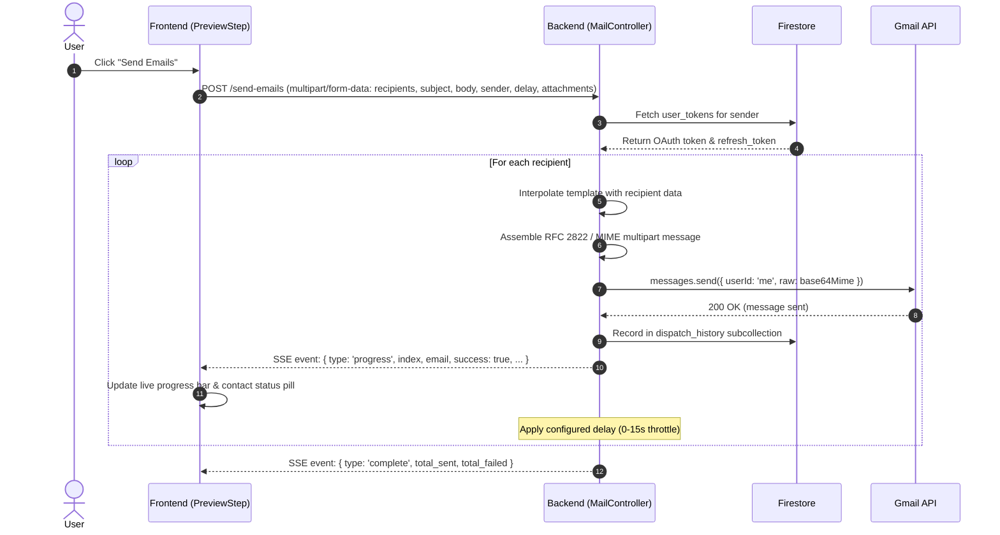

# iEmail Architecture & System Design

This document details the architectural design, core subsystems, data flows, and security boundaries of the **iEmail** platform.

---

## 1. System Overview

iEmail is a lightweight, privacy-centric bulk email platform that sends personalized emails directly through a user's Google Gmail or Google Workspace account without routing email contents through external databases.

### Core Stack
- **Frontend**: Next.js 16 (App Router), React 19, TypeScript, TailwindCSS (Vanilla CSS tokens), Framer Motion, Lucide Icons, GitHub Dark Toast System.
- **Backend**: NestJS 11, Express, TypeScript, Googleapis SDK, Firebase Admin SDK, RxJS, Sharp (image compression).
- **Authentication**: Firebase Authentication (Google OAuth 2.0 provider with `gmail.send` scope).
- **Persistence**: Google Cloud Firestore (stores encrypted OAuth refresh tokens and sent email dispatch history).



---

## 2. Key Subsystems & Workflows

### 2.1. Authentication & Google OAuth 2.0 Flow
1. User clicks **"Continue with Google"** on the frontend.
2. Firebase client SDK opens a Google OAuth popup requesting:
   - `https://www.googleapis.com/auth/gmail.send`
   - `https://www.googleapis.com/auth/userinfo.email`
   - `https://www.googleapis.com/auth/userinfo.profile`
3. Upon authorization, the frontend receives an access token and user credentials.
4. The frontend generates a unique, persistent `deviceId` (stored in `localStorage`) and calls `POST /auth/sync` with:
   - `email`, `name`, `picture`, `token_json`, and `deviceId`.
5. The backend stores the tokens in Firestore under `user_tokens/{email}` and maps the `deviceId`.

### 2.2. Spreadsheet Ingestion (Zero-Retention Model)
1. The user drags and drops an `.xlsx`, `.xls`, or `.csv` contact spreadsheet in [`FileUpload.tsx`](file:///home/gericandmorty/Desktop/Projects/iEmail/frontend/components/FileUpload.tsx).
2. The file is parsed **exclusively inside the browser** using SheetJS (`xlsx`) in [`lib/excel-utils.ts`](file:///home/gericandmorty/Desktop/Projects/iEmail/frontend/lib/excel-utils.ts).
3. The raw file contents are never transmitted to the backend until the user explicitly dispatches the final email batch.

### 2.3. Dynamic Tag Interpolation
- Column headers (e.g., `Name`, `Company`, `Role`) are automatically detected as available tags.
- In the composer, tags are inserted using double curly braces: `{{Name}}`, `{{Company}}`.
- Special reserved tags include:
  - `{{today}}`: Evaluates to current formatted date (e.g., *October 22, 2026*).
  - `{{recipient}}`: Evaluates to mapped name or falls back to `Friend`.
- In [`PreviewStep.tsx`](file:///home/gericandmorty/Desktop/Projects/iEmail/frontend/components/PreviewStep.tsx), users preview personalized rendered HTML per contact with live substitution.

### 2.4. Real-time Email Dispatch via Server-Sent Events (SSE)


---

## 3. GitHub Dark Theme Design System

The frontend user interface adheres strictly to a **GitHub-inspired dark design system** implemented via custom CSS variables and utility classes in [`app/globals.css`](file:///home/gericandmorty/Desktop/Projects/iEmail/frontend/app/globals.css):

| Token Name | Hex Code | Purpose |
|---|---|---|
| `--color-canvas-default` | `#0D1117` | Root background for all pages |
| `--color-canvas-subtle` | `#161B22` | Cards, panels, sidebar, modal background |
| `--color-canvas-inset` | `#21262D` | Input fields, active tab states, icon wrappers |
| `--color-border-default` | `#30363D` | Standard 1px borders, dividers, outlines |
| `--color-fg-default` | `#E6EDF3` | High-contrast primary text |
| `--color-fg-muted` | `#8B949E` | Secondary captions, helper hints, timestamps |
| `--color-accent-fg` | `#58A6FF` | Link colors, active indicators, focus rings |
| `--color-success-fg` | `#238636` / `#3FB950` | Primary action buttons (`git commit` green), success badges |
| `--color-danger-fg` | `#F85149` | Destructive buttons, error alerts |
| `--color-warning-fg` | `#D29922` | Rate-limit/throttle warnings |

---

## 4. Frontend Component Hierarchy

```
app/
 ├── layout.tsx         # Root layout with Geist font & metadata
 ├── globals.css        # GitHub dark theme tokens & scrollbars
 ├── page.tsx           # Entry route: handles auth state, redirects, view switching
 ├── docs/page.tsx      # Step-by-step help & guide
 ├── privacy/page.tsx   # Plain-language privacy policy
 └── tos/page.tsx       # Plain-language terms of service
components/
 ├── ui-components.tsx  # GitHub-styled Button, Card, Input, Label, Badge
 ├── Navbar.tsx         # Sticky header with brand logo & navigation
 ├── Footer.tsx         # Minimalist GitHub-style footer
 ├── LandingPage.tsx    # Unauthenticated landing page with hero, features & FAQ
 ├── LoginModal.tsx     # Google OAuth sign-in modal
 ├── EmailSeeder.tsx    # Primary workspace controller for logged-in users
 ├── Sidebar.tsx        # Navigation sidebar (Contacts, Compose, Preview, Templates)
 ├── FileUpload.tsx     # Drag-and-drop Excel/CSV upload with table search
 ├── TemplateStep.tsx   # Subject, sending speed slider, tag selectors, attachment manager
 ├── EmailEditor.tsx    # Rich text editor with tag injection & image resizing
 ├── TemplatesView.tsx  # Template management grid with quick insert
 ├── PreviewStep.tsx    # Contact browser, HTML preview, pre-flight modal, SSE stream tracker
 └── ProtocolLoader.tsx # Clean loading indicator
```

---

## 5. Security & Boundary Recommendations

1. **Token Transport**: Transition from transmitting client-side tokens via `localStorage` to `HttpOnly`, `SameSite=Strict` cookies.
2. **Backend Authentication**: Attach a Bearer token verification guard on all NestJS endpoints using Firebase Admin's `verifyIdToken()`.
3. **MIME Sanitization**: Before calling `gmail.users.messages.send()`, pass user-composed HTML through an allowlist sanitizer to remove potentially dangerous tags (e.g. `<object>`, `<embed>`, `<form>`).
